# Lab 09 – Sistema de Registro de Contacto (PHP & JSP)

**Universidad Nacional del Centro del Perú – Facultad de Ingeniería de Sistemas**
**Asignatura:** Desarrollo de Aplicaciones Web (IS093A)
**Unidad II:** Desarrollo Web Fullstack
**Guía:** Práctica Semana 09 – Tecnología Web Backend, Arquitectura Cliente-Servidor, PHP & JSP
**Fecha:** 29/10/2026
**Autora:** Jackeline Vivanco Solano – 2022100549I
**Modalidad:** Trabajo individual (los 4 roles técnicos asumidos por la autora)

---

## Índice
1. [Descripción](#1-descripción)
2. [Roles técnicos asumidos](#2-roles-técnicos-asumidos)
3. [Estructura del repositorio](#3-estructura-del-repositorio)
4. [Configuración del entorno y despliegue](#4-configuración-del-entorno-y-despliegue)
5. [Aplicación PHP](#5-aplicación-php)
6. [Aplicación JSP](#6-aplicación-jsp)
7. [Ciclo de vida HTTP](#7-ciclo-de-vida-http)
8. [Seguridad básica](#8-seguridad-básica)
9. [Pruebas HTTP](#9-pruebas-http)
10. [Matriz comparativa PHP vs JSP](#10-matriz-comparativa-php-vs-jsp)
11. [Conclusiones](#11-conclusiones)

---

## 1. Descripción
Sistema de Registro de Contacto implementado en dos tecnologías backend: **PHP** (desplegado en Apache/XAMPP) y **JSP** (desplegado en Apache Tomcat). Ambos reciben nombre y correo mediante un formulario, validan y sanitizan los datos, los almacenan en la sesión del usuario y responden con una tabla de registros.

## 2. Roles técnicos asumidos
| Rol | Responsabilidad | Estado |
|---|---|---|
| Arquitecto de Despliegue | Configuración XAMPP/Tomcat, rutas htdocs/webapps, puertos, logs | ✅ |
| Desarrolladora PHP | `$_POST`, validación, `session_start()`, `htmlspecialchars` | ✅ |
| Desarrolladora JSP | `request.getParameter()`, session, EL/JSTL, `web.xml` | ✅ |
| QA & Documentadora | Pruebas HTTP, validación de seguridad, matriz, README | ✅ |

> Al ser un trabajo individual, el avance de cada rol puede seguirse en el historial de *commits* del repositorio.

## 3. Estructura del repositorio
```
lab09-registro-contacto/
├── php-app/          # Aplicación PHP (Apache/XAMPP)
├── jsp-app/          # Aplicación JSP (Apache Tomcat)
├── docs/
│   ├── capturas/         # Evidencias del laboratorio
│   └── pruebas-http.bat  # Pruebas HTTP automatizadas con curl
├── .gitignore
└── README.md
```

### 3.1 Creación del repositorio
Se creó el repositorio en GitHub y se inicializó localmente con Git.

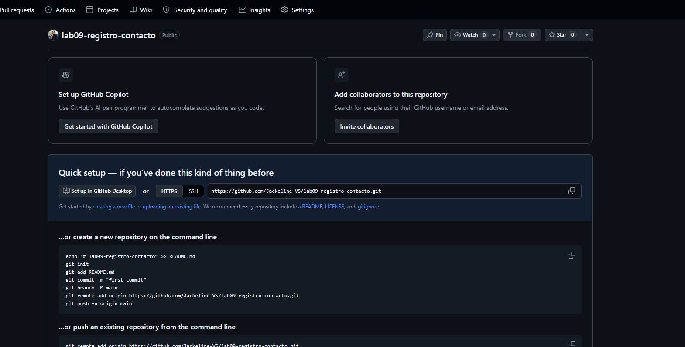
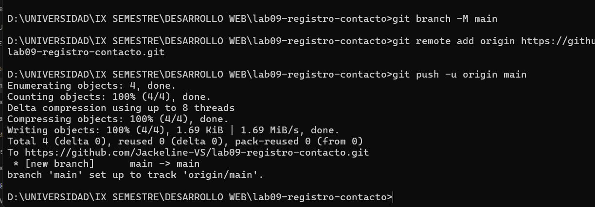

## 4. Configuración del entorno y despliegue

### 4.1 Entorno utilizado
| Componente | Versión / Detalle |
|---|---|
| Sistema operativo | Windows 11 |
| Servidor PHP | Apache (XAMPP) – puerto **8080** (SSL 444) |
| Servidor JSP | Apache Tomcat **8.5.96** (incluido en XAMPP) – puerto **8081** |
| Java | OpenJDK **25** (Eclipse Temurin) – `JAVA_HOME` configurado |
| JSTL | 1.2 (espacio de nombres `javax`, compatible con Tomcat 8.5) |
| Control de versiones | Git + GitHub |

### 4.2 Estrategia de despliegue: enlaces de directorio (junctions)
Para no duplicar código, las carpetas del repositorio se enlazan con las carpetas de despliegue de cada servidor mediante *junctions* de Windows. Así, cualquier cambio en el repositorio se refleja inmediatamente en el servidor.

```cmd
mklink /J C:\xampp\htdocs\lab09-php "D:\UNIVERSIDAD\IX SEMESTRE\DESARROLLO WEB\lab09-registro-contacto\php-app"
mklink /J C:\xampp\tomcat\webapps\lab09-jsp "D:\UNIVERSIDAD\IX SEMESTRE\DESARROLLO WEB\lab09-registro-contacto\jsp-app"
```

| Aplicación | Carpeta en el repo | Ruta de despliegue | URL |
|---|---|---|---|
| PHP | `php-app/` | `C:\xampp\htdocs\lab09-php` | http://localhost:8080/lab09-php/ |
| JSP | `jsp-app/` | `C:\xampp\tomcat\webapps\lab09-jsp` | http://localhost:8081/lab09-jsp/ |

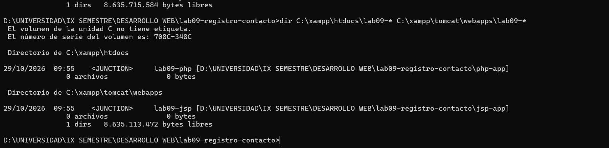

### 4.3 Configuración de puertos (conflicto resuelto)
Al iniciar Tomcat, el Panel de XAMPP reportó que el puerto **8080** ya estaba ocupado por Apache (`httpd.exe`), que en este equipo escucha en 8080 y 444. Tomcat no podía iniciar sin ese puerto libre.

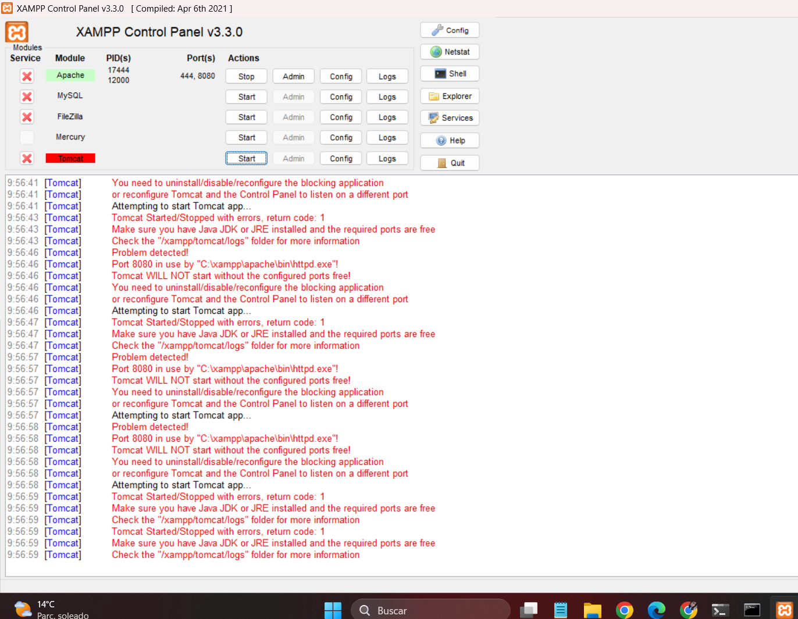

**Solución:** se reasignó el conector HTTP de Tomcat al puerto **8081**:

1. En `C:\xampp\tomcat\conf\server.xml` se cambió `<Connector port="8080" protocol="HTTP/1.1"` por `<Connector port="8081" protocol="HTTP/1.1"`.
2. En el Panel de XAMPP: *Config → Service and Port Settings → Tomcat → Main Port = 8081*.

**Segundo conflicto – puerto de apagado (8005):** con el conector ya en 8081, Tomcat arrancaba (`Server startup in 1571 ms`) pero se detenía de inmediato con:

```
GRAVE [main] org.apache.catalina.core.StandardServer.await Failed to create server
shutdown socket on address [localhost] and port [8005]
java.net.BindException: Address already in use: bind
```

`netstat -ano | findstr :8005` no mostraba ningún proceso usando el puerto, lo que indica que Windows lo tiene dentro de un **rango de puertos reservado** (Hyper-V/WSL), consultable con `netsh interface ipv4 show excludedportrange protocol=tcp`.

**Solución:** en `server.xml` se cambió `<Server port="8005" shutdown="SHUTDOWN">` por `<Server port="9005" shutdown="SHUTDOWN">`. Tomcat se ejecuta con `catalina.bat run` desde `C:\xampp\tomcat\bin`.

| Servidor | Puerto(s) |
|---|---|
| Apache (HTTP / HTTPS) | 8080 / 444 |
| Tomcat (HTTP / Shutdown) | 8081 / 9005 (AJP 8009 deshabilitado por defecto) |

### 4.4 Servidores en ejecución
Log de arranque de Tomcat: se observa el despliegue de `lab09-jsp` desde el enlace y el inicio del conector `http-nio-8081`.

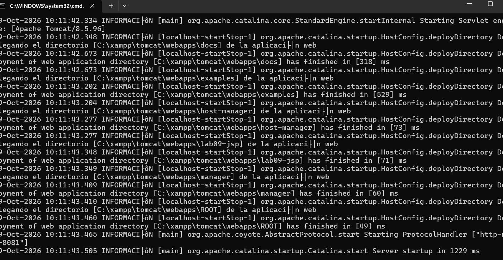
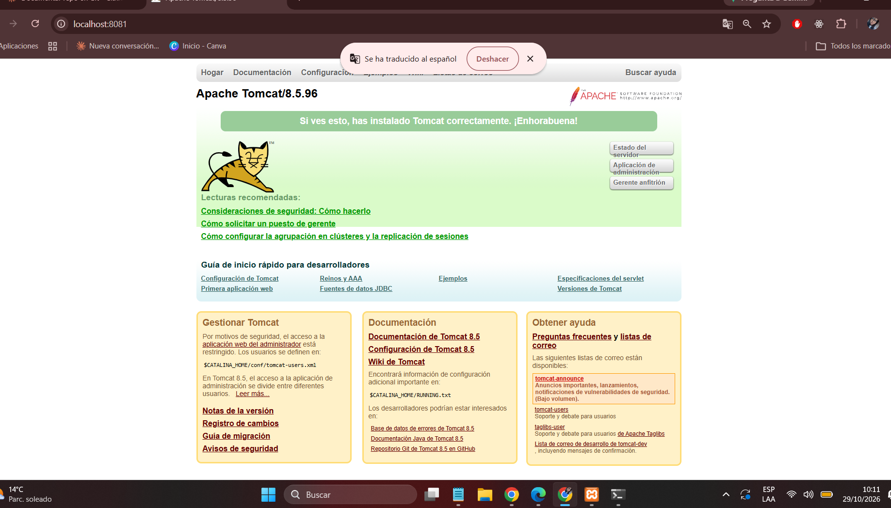

### 4.5 Logs de los servidores
| Servidor | Log de accesos | Log de errores |
|---|---|---|
| Apache | `C:\xampp\apache\logs\access.log` | `C:\xampp\apache\logs\error.log` |
| Tomcat | `C:\xampp\tomcat\logs\localhost_access_log.AAAA-MM-DD.txt` | `C:\xampp\tomcat\logs\catalina.AAAA-MM-DD.log` |

## 5. Aplicación PHP

### 5.1 Estructura
```
php-app/
├── index.html        # Formulario (POST → procesar.php)
├── procesar.php      # Valida, sanitiza, guarda en $_SESSION y responde
├── registros.php     # Lista los registros de la sesión (GET) y permite vaciarlos
├── funciones.php     # Funciones compartidas: sesión, escape e(), tabla
├── estilos.css       # Estilos comunes
├── .htaccess         # Páginas de error 4xx/5xx, sin listado de carpetas
└── errores/
    └── error.php     # Página de error personalizada (403/404/500)
```

### 5.2 Flujo de `procesar.php`
| Paso | Implementación | Respuesta si falla |
|---|---|---|
| 1. Validar método | `$_SERVER['REQUEST_METHOD'] !== 'POST'` | **405** + cabecera `Allow: POST` |
| 2. Sanitizar | `filter_input(INPUT_POST, …, FILTER_UNSAFE_RAW, FILTER_FLAG_STRIP_LOW)` + `trim()`; correo con `FILTER_SANITIZE_EMAIL` | – |
| 3. Validar | Nombre: 2–60 caracteres, solo letras (incluye tildes y ñ), espacios, `.`, `'`, `-`. Correo: `FILTER_VALIDATE_EMAIL`, máx. 100 | **400** con lista de errores |
| 4. Guardar | `session_start()` (cookie `HttpOnly` + `SameSite=Strict`) y `$_SESSION['registros'][]` | – |
| 5. Responder | **201 Created** + tabla de registros; cada valor pasa por `htmlspecialchars()` | – |

Fragmento clave:
```php
$nombre = trim((string) filter_input(INPUT_POST, 'nombre', FILTER_UNSAFE_RAW, FILTER_FLAG_STRIP_LOW));
$correo = trim((string) filter_input(INPUT_POST, 'correo', FILTER_SANITIZE_EMAIL));
// ...
$_SESSION['registros'][] = ['nombre' => $nombre, 'correo' => $correo, 'fecha' => date('d/m/Y H:i:s')];
// ...
echo '<td>' . e($r['nombre']) . '</td>';   // e() = htmlspecialchars(..., ENT_QUOTES, 'UTF-8')
```

### 5.3 Capturas
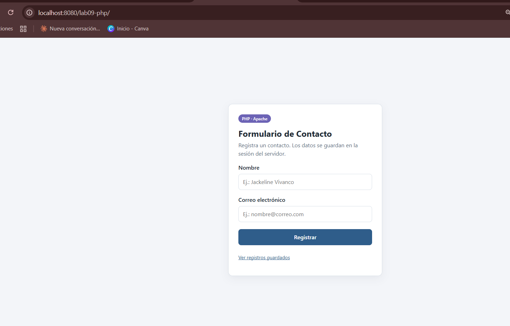
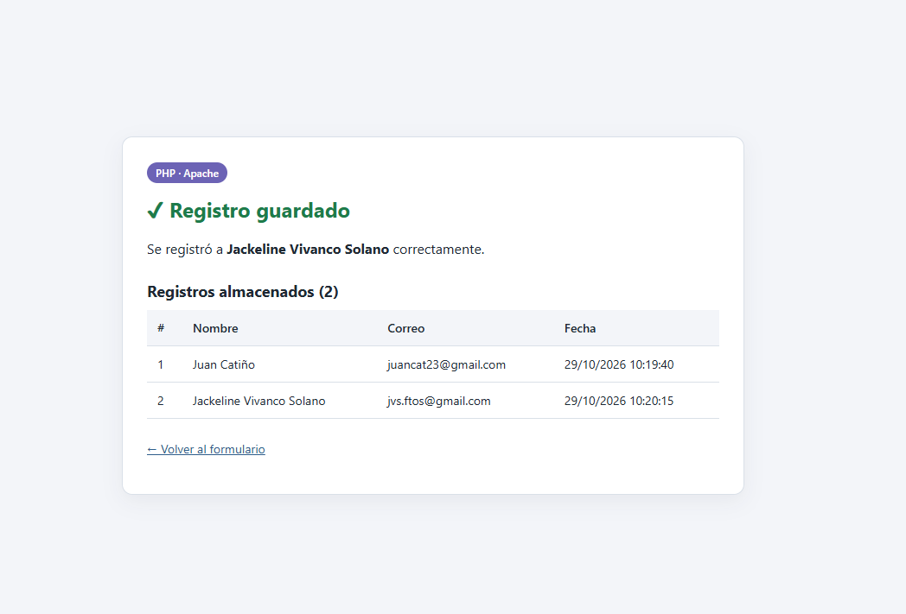

## 6. Aplicación JSP

### 6.1 Estructura
```
jsp-app/
├── index.jsp           # Formulario (POST → procesar.jsp)
├── procesar.jsp        # Valida, guarda en HttpSession y responde con JSTL
├── registros.jsp       # Lista los registros de la sesión (GET) y permite vaciarlos
├── estilos.css         # Estilos comunes
├── errores/
│   └── error.jsp       # Página de error (isErrorPage) para 403/404/405/500
└── WEB-INF/
    ├── web.xml         # Servlet 3.1: welcome-file, sesión, <error-page>
    ├── tabla.jsp       # Fragmento con <c:forEach> + <c:out> (no accesible por URL)
    └── lib/
        ├── taglibs-standard-impl-1.2.5.jar   # JSTL 1.2
        └── taglibs-standard-spec-1.2.5.jar
```

Los JAR de JSTL se tomaron del propio Tomcat 8.5 (`webapps/examples/WEB-INF/lib`), por lo que no hubo que descargar dependencias externas.

### 6.2 Flujo de `procesar.jsp`
| Paso | Implementación | Respuesta si falla |
|---|---|---|
| 1. Validar método | `"POST".equals(request.getMethod())` | **405** + cabecera `Allow: POST` |
| 2. Leer parámetros | `request.setCharacterEncoding("UTF-8")` + `request.getParameter()` + `trim()` | – |
| 3. Validar | Nombre: 2–60 caracteres, regex `^[\p{L} .'-]+$`. Correo: regex de formato, máx. 100 | **400** con lista de errores |
| 4. Guardar | `session.getAttribute("registros")` → `List<Map<String,String>>` → `session.setAttribute(...)` | – |
| 5. Responder | **201 Created** + tabla con `<c:forEach>`; cada valor con `<c:out>` | – |

Fragmento clave:
```jsp
<%@ taglib prefix="c" uri="http://java.sun.com/jsp/jstl/core" %>
...
<c:forEach var="r" items="${sessionScope.registros}" varStatus="st">
  <tr>
    <td>${st.count}</td>
    <td><c:out value="${r.nombre}"/></td>   <%-- <c:out> escapa HTML → anti-XSS --%>
    <td><c:out value="${r.correo}"/></td>
  </tr>
</c:forEach>
```

> **Compatibilidad:** el código base usaba `Map.of(...)` (Java 9+). Se reemplazó por `HashMap` porque el compilador de JSP de Tomcat 8.5 trabaja por defecto con nivel de código fuente antiguo.

### 6.3 Capturas
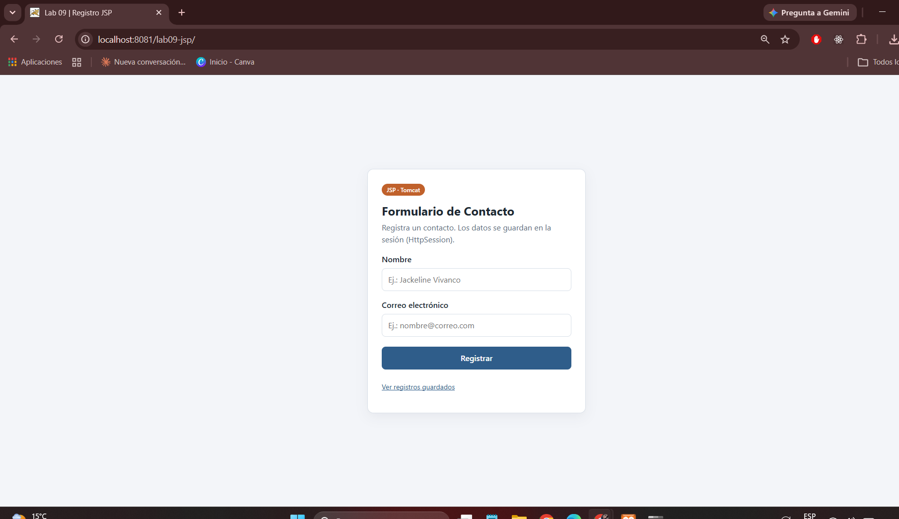
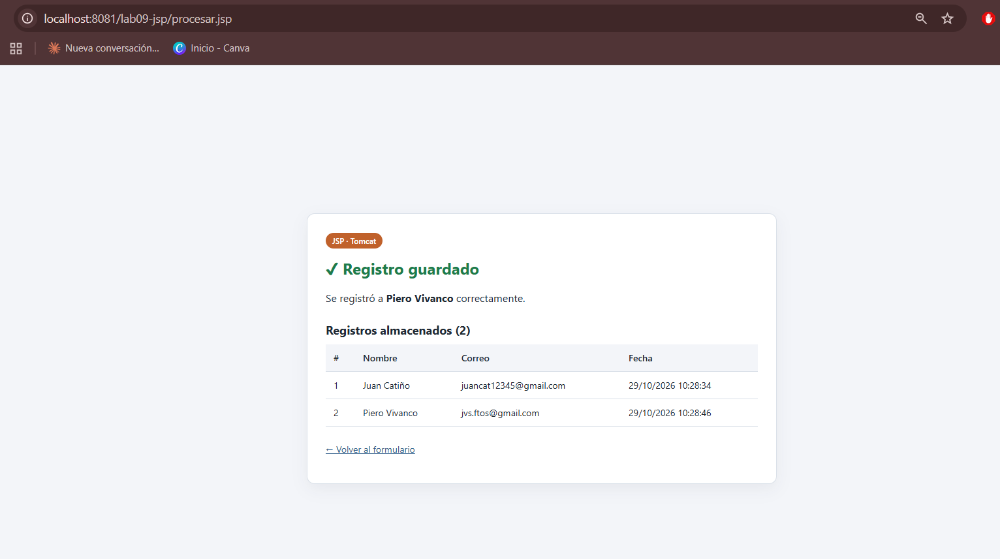

## 7. Ciclo de vida HTTP

### 7.1 Diagrama de flujo (Cliente → Servidor → Backend → Respuesta)
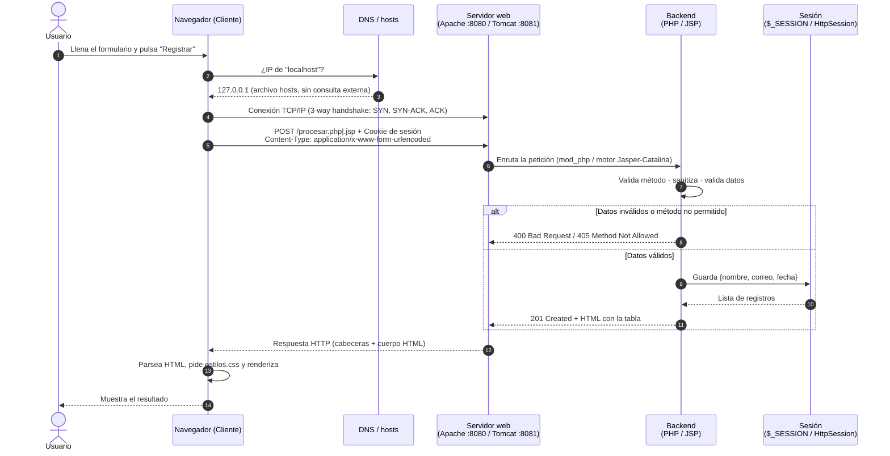

### 7.2 Descripción de cada etapa
| # | Etapa | Qué ocurre en este laboratorio |
|---|---|---|
| 1 | **Cliente** | El navegador construye la petición a partir del `<form method="POST">`. |
| 2 | **DNS** | `localhost` se resuelve a `127.0.0.1` mediante el archivo *hosts* del sistema; en Internet sería una consulta a servidores DNS. |
| 3 | **TCP/IP** | Se abre una conexión TCP al puerto 8080 (Apache) o 8081 (Tomcat) con el *three-way handshake*. |
| 4 | **HTTP Request** | `POST /lab09-php/procesar.php` (o `.jsp`) con los campos `nombre` y `correo` en el cuerpo y la cookie `PHPSESSID` / `JSESSIONID`. |
| 5 | **Server** | Apache entrega la petición al módulo PHP; Tomcat (Catalina) la entrega al servlet generado por Jasper a partir del JSP. |
| 6 | **Backend** | Valida el método, sanitiza y valida los datos, y lee o escribe la sesión. |
| 7 | **Response** | Código de estado (201, 400, 405, 404…), cabeceras (`Content-Type`, `Set-Cookie`, `Allow`) y cuerpo HTML. |
| 8 | **Render** | El navegador interpreta el HTML, descarga `estilos.css` y dibuja la página. |

## 8. Seguridad básica
| Control | PHP | JSP |
|---|---|---|
| **Prevención XSS** | `htmlspecialchars($v, ENT_QUOTES, 'UTF-8')` en toda salida de datos del usuario | `<c:out value="${...}"/>` en toda salida de datos del usuario |
| **Solo POST** | `$_SERVER['REQUEST_METHOD'] !== 'POST'` → 405 + `Allow: POST` | `!"POST".equals(request.getMethod())` → 405 + `Allow: POST` |
| **Validación de entrada** | Longitud, regex Unicode para nombre, `FILTER_VALIDATE_EMAIL` | Longitud, regex `\p{L}` para nombre, regex de correo |
| **Sanitización** | `filter_input` + `FILTER_FLAG_STRIP_LOW` + `trim()`, `FILTER_SANITIZE_EMAIL` | `trim()` + validación estricta por regex |
| **Codificación** | UTF-8 en `<meta>` y `htmlspecialchars` | `setCharacterEncoding("UTF-8")` + `pageEncoding="UTF-8"` |
| **Cookie de sesión** | `HttpOnly` + `SameSite=Strict` | `<http-only>true</http-only>` en `web.xml` |
| **Errores 4xx/5xx** | `ErrorDocument` 403/404/500 en `.htaccess` → `errores/error.php` | `<error-page>` 403/404/405/500 y `Throwable` en `web.xml` → `errores/error.jsp` |
| **Archivos internos** | `funciones.php` bloqueado (`Require all denied`), `Options -Indexes` | `tabla.jsp` y `web.xml` dentro de `WEB-INF/` (no accesibles por URL) |

## 9. Pruebas HTTP

### 9.1 Pruebas funcionales en el navegador
| App | Formulario | Registros en sesión |
|---|---|---|
| PHP |  |  |
| JSP |  |  |

### 9.2 Pruebas automatizadas con `curl`
El script [`docs/pruebas-http.bat`](docs/pruebas-http.bat) envía 16 peticiones (8 por tecnología) y muestra el código HTTP obtenido frente al esperado:

| ID | Prueba | Esperado |
|---|---|---|
| P1 / J1 | GET del formulario | 200 |
| P2 / J2 | GET a `procesar` (método no permitido) | 405 |
| P3 / J3 | POST con `<script>alert(1)</script>` como nombre | 400 |
| P4 / J4 | POST con correo inválido | 400 |
| P5 / J5 | POST con campos vacíos | 400 |
| P6 / J6 | POST con datos válidos | 201 |
| P7 / J7 | GET a recurso inexistente | 404 |
| P8 | GET directo a `funciones.php` | 403 |
| J8 | GET a `WEB-INF/web.xml` | 404 |

Además, verifica que el intento de XSS regresa **escapado** (`&lt;script&gt;`) en ambas tecnologías.

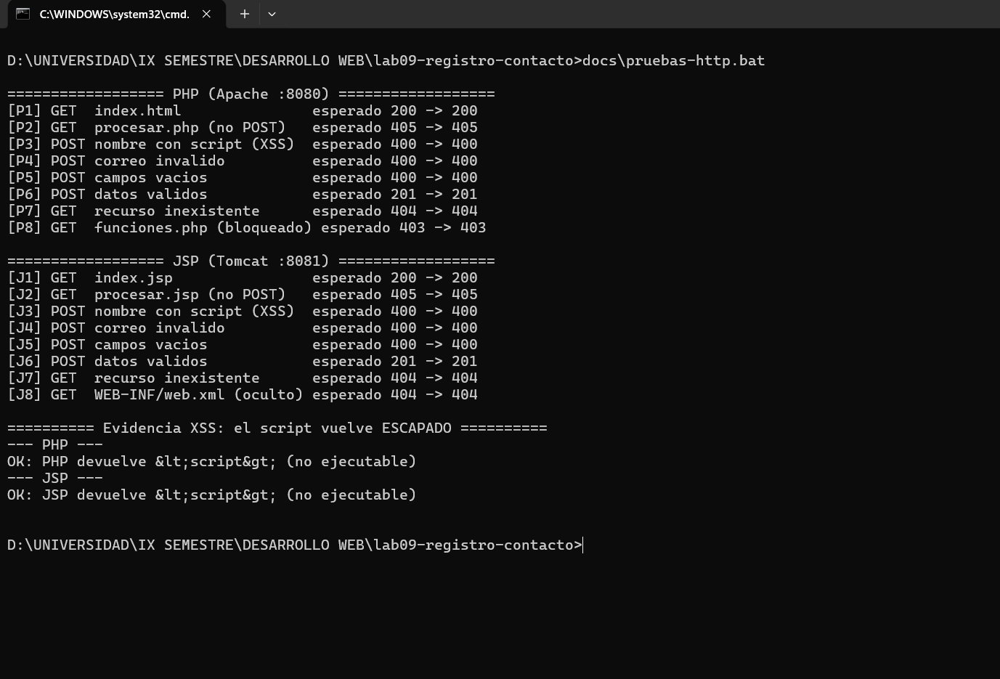

### 9.3 Respuesta HTTP con cabeceras
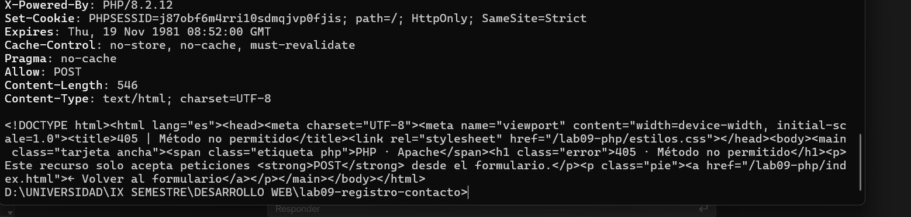
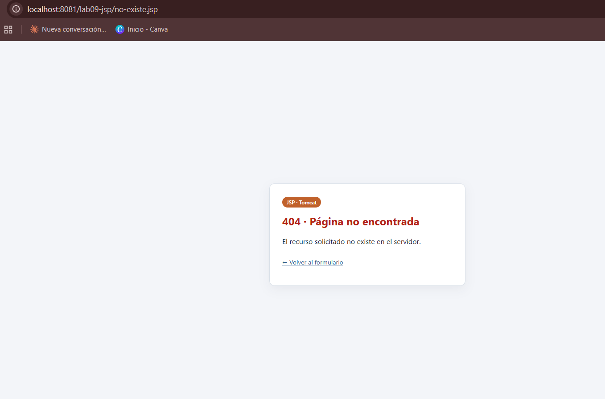

### 9.4 Logs de acceso
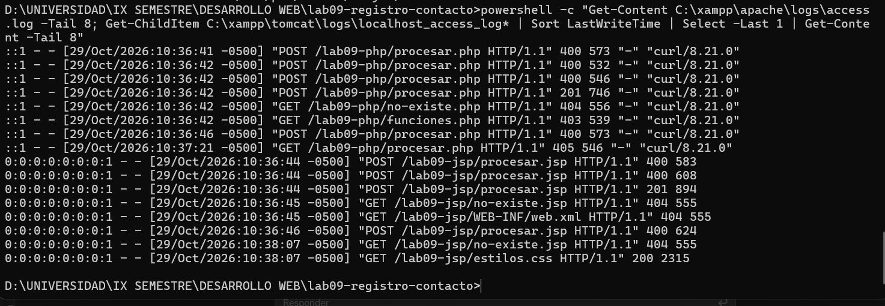

### 9.5 Estructura de carpetas
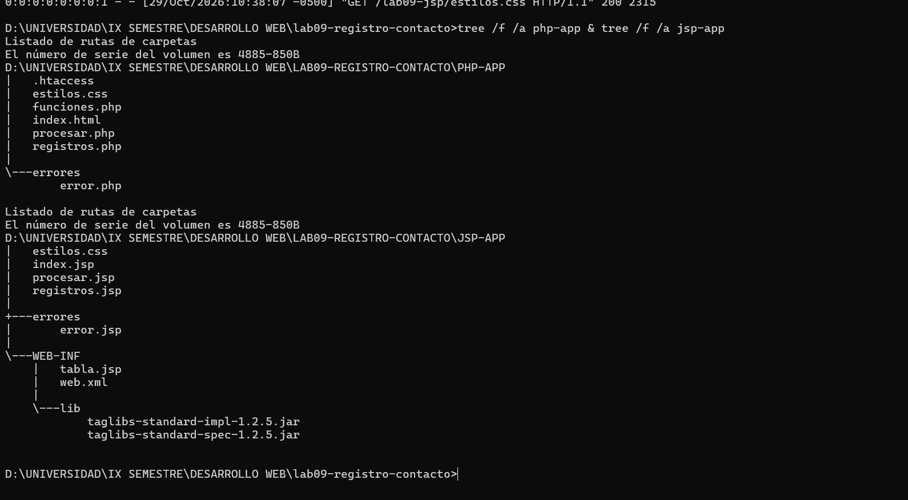

## 10. Matriz comparativa PHP vs JSP
| Criterio | PHP (Apache + mod_php) | JSP (Tomcat) |
|---|---|---|
| **Ciclo de vida** | Interpretado por petición: cada solicitud carga y ejecuta el script desde cero (con OPcache cacheando el *bytecode*). No hay estado en memoria entre peticiones. | El JSP se **traduce a un servlet Java** (Jasper), se **compila** a `.class` y se carga una sola vez: `jspInit()` → `_jspService()` por cada petición → `jspDestroy()`. La primera petición es más lenta. |
| **Rendimiento** | Arranque inmediato y bajo consumo de memoria; muy eficiente en sitios pequeños y medianos. | Tras la compilación inicial es muy rápido gracias a la JVM (JIT, multihilo), aunque Tomcat consume más memoria. Escala bien con carga alta. |
| **Despliegue** | Copiar archivos a `htdocs/`; los cambios se ven al recargar. Sin compilación previa. | Carpeta o archivo `.war` en `webapps/`; requiere estructura `WEB-INF/`, `web.xml` y librerías en `WEB-INF/lib`. Tomcat recompila el JSP cuando cambia. |
| **Configuración** | `php.ini`, `httpd.conf`, `.htaccess` por carpeta. | `server.xml` (puertos, conectores), `web.xml` por aplicación. |
| **Gestión de estado** | `session_start()` + `$_SESSION` (arreglo); por defecto guarda en archivos del servidor. Cookie `PHPSESSID`. | `HttpSession` (`session.getAttribute/setAttribute`) guarda **objetos Java** en memoria de la JVM. Cookie `JSESSIONID`. |
| **Seguridad** | `htmlspecialchars`, `filter_input`/`filter_var`; tipado dinámico, por lo que hay que validar con cuidado. | `<c:out>` (y EL), tipado fuerte de Java, `WEB-INF` protegido por el contenedor, *security constraints* declarativas en `web.xml`. |
| **Manejo de errores** | `http_response_code()`, `ErrorDocument` en Apache. | `response.setStatus()` / `sendError()`, `<error-page>` en `web.xml`, `isErrorPage`. |
| **Madurez del ecosistema** | Muy amplio en hosting compartido; frameworks como Laravel y Symfony; CMS como WordPress. | Ecosistema Java/Jakarta EE empresarial: Spring, JSF, Jakarta EE. Hoy JSP se usa sobre todo como vista legada; la tendencia es Thymeleaf o *frontends* separados. |
| **Curva de aprendizaje** | Baja: se mezcla HTML y PHP rápidamente. | Media/alta: requiere Java, el modelo servlet, la estructura `WEB-INF` y JSTL/EL. |

## 11. Conclusiones
1. Ambas tecnologías resuelven el mismo flujo (formulario → validación → sesión → respuesta), pero con modelos distintos: PHP interpreta el script en cada petición, mientras que JSP se compila a un servlet que permanece cargado en la JVM.
2. El despliegue en PHP fue inmediato (copiar a `htdocs`). JSP exigió más configuración: estructura `WEB-INF`, `web.xml` y librerías JSTL.
3. La configuración de puertos es parte esencial del despliegue: hubo que resolver dos conflictos (8080 ocupado por Apache y 8005 reservado por Windows) moviendo Tomcat a 8081 y su puerto de apagado a 9005.
4. La prevención de XSS depende de **escapar toda salida** (`htmlspecialchars` / `<c:out>`), complementado con validación en el servidor. La validación HTML5 del navegador no basta, como demuestran las pruebas con `curl`, que la saltan.
5. El uso de códigos HTTP correctos (201, 400, 403, 404, 405) hace que las aplicaciones sean predecibles y fáciles de probar de forma automatizada.
